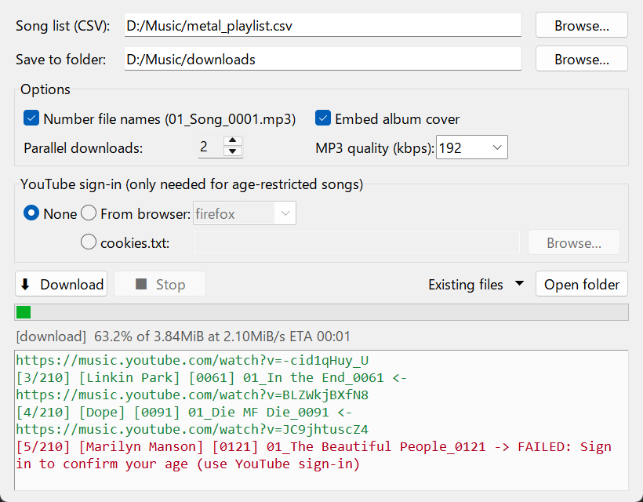

# Music Downloader

Download songs from YouTube / YouTube Music as MP3 files **with album covers**, sorted into one
folder per artist (or any category you like), from a simple CSV list. Comes with a Windows app
and a command-line tool.



## Features

- **CSV song lists**: `name,category,link`, so each category (e.g. artist) gets its own folder
- **Album covers embedded** in every MP3, so artwork shows up in Apple Music / iTunes, Windows Media Player and other players
- **Numbered or plain file names**: `01_Duality_0001.mp3` or just `Duality.mp3`
- **Switch names later without re-downloading** (numbered ↔ plain)
- **Add covers to songs you already downloaded**, without downloading them again
- **Resumable**: already-downloaded songs are skipped; stop any time and continue later
- **Parallel downloads** with built-in pacing to avoid YouTube rate limits
- **YouTube sign-in** via browser cookies or `cookies.txt` for age-restricted songs

## Download (Windows)

**With winget** (installs FFmpeg too; available once the winget listing is approved):

```powershell
winget install PhyoeBlitz.MusicDownloader
```

Then run `music-downloader-gui` (app) or `music-downloader` (command line) from a new terminal.

**Or manually:** get **MusicDownloader-windows.zip** from the [latest release](../../releases/latest). It contains:

| File | What it is |
|---|---|
| `MusicDownloaderGUI.exe` | The app: double-click to open |
| `MusicDownloader.exe` | Command-line version |
| `README.txt` | Setup and usage |
| `sample.csv` | Example song list |

With the zip you also need **FFmpeg**: run `winget install Gyan.FFmpeg`, or copy `ffmpeg.exe` and
`ffprobe.exe` next to the exes. [Node.js](https://nodejs.org) is optional but makes YouTube downloads more reliable.

> The exes aren't code-signed, so Windows may show *"Windows protected your PC"*.
> To avoid it, unblock the zip **before** extracting: right-click it → **Properties** → tick
> **Unblock** → OK (or `Unblock-File .\MusicDownloader-windows.zip`). Otherwise click
> **More info → Run anyway**.

## Song list format

```csv
name,category,link
Duality,Slipknot,https://music.youtube.com/watch?v=B2lmOei7qfk
Psychosocial,Slipknot,https://music.youtube.com/watch?v=-XlW-cyAdiw
```

| Column | Meaning |
|---|---|
| `name` | Song title used for the file name (leave blank to use the video title) |
| `category` | Folder name, e.g. the artist (optional column) |
| `link` | YouTube or YouTube Music link; several links in one cell are allowed |

Files are saved as `<output>/<category>/01_Song Title_0001.mp3`. The first number restarts per
category and follows the row order. The last number is unique across the whole list and is also
written to the MP3's Comment tag. Example lists are in [`examples/`](examples).

## Using the app

1. Choose your **song list (CSV)** and a **folder to save to**.
2. Pick options: numbered names, album covers, parallel downloads, MP3 quality.
3. Click **Download**. Click **Stop** to stop; finished songs are kept and the rest continue next time.
4. **Existing files** menu: add album covers to songs already downloaded, or rename them between
   numbered and plain names.

## Command line

```powershell
MusicDownloader.exe --csv songs.csv                                # download to .\downloads
MusicDownloader.exe --csv songs.csv --out D:\Music --no-numbering  # plain names: Song.mp3
MusicDownloader.exe --csv songs.csv --cookies-from-browser firefox # age-restricted songs
MusicDownloader.exe --csv songs.csv --rename plain --dry-run       # preview a rename
MusicDownloader.exe --csv songs.csv --rename numbered              # rename back
MusicDownloader.exe --csv songs.csv --add-artwork                  # add covers, no re-download
MusicDownloader.exe -h                                             # all options
```

| Option | Description |
|---|---|
| `--csv FILE` | Song list (required) |
| `--out DIR` | Output folder (default `downloads`) |
| `--no-numbering` | Save as `Song.mp3` instead of `01_Song_0001.mp3` |
| `--no-artwork` | Don't embed album covers |
| `--workers N` | Songs downloaded in parallel (default 2, keep it low) |
| `--quality KBPS` | MP3 bitrate (default 192) |
| `--format FMT` | Audio format (default mp3) |
| `--cookies-from-browser BROWSER` | Use your browser's YouTube sign-in (`firefox`, `chrome`, `edge`, …) |
| `--cookies FILE` | Use an exported `cookies.txt` |
| `--rename plain\|numbered` | Rename existing files instead of downloading |
| `--dry-run` | With `--rename`: only show what would change |
| `--add-artwork` | Embed covers into existing files instead of downloading |
| `--js-runtime NAME` | JavaScript runtime for YouTube (default `auto`) |

Press **Ctrl+C** to stop (twice to quit immediately).

## Run from source

```powershell
python -m venv .venv
.\.venv\Scripts\pip install -r requirements.txt
.\.venv\Scripts\python gui.py                          # app
.\.venv\Scripts\python download_music.py --csv songs.csv  # command line
```

Requires Python 3.10+ and FFmpeg on PATH.

### Build the exes

```powershell
.\.venv\Scripts\pip install pyinstaller
.\.venv\Scripts\pyinstaller --onefile --console  --name MusicDownloader    --collect-all yt_dlp_ejs download_music.py
.\.venv\Scripts\pyinstaller --onefile --windowed --name MusicDownloaderGUI --collect-all yt_dlp_ejs gui.py
```

Releases are built by GitHub Actions when a `v*` tag is pushed (see `.github/workflows/release.yml`),
which also sends the new version to winget (see [`packaging/winget`](packaging/winget)).

## Troubleshooting

| Message | Fix |
|---|---|
| `Could not find ffmpeg` | Install FFmpeg (see above) or put `ffmpeg.exe` / `ffprobe.exe` next to the exe |
| `Sign in to confirm you're not a bot` | Wait a while, lower `--workers`, or use YouTube sign-in |
| `Sign in to confirm your age` | Use `--cookies-from-browser firefox` (signed in to YouTube) or a fresh `cookies.txt` |
| Downloads suddenly fail | Update yt-dlp: `pip install -U yt-dlp yt-dlp-ejs` (or get the latest release) |

## Privacy

This program will not transfer any information to other networked systems unless specifically
requested by the user or the person installing or operating it. It only connects to YouTube /
YouTube Music (and the thumbnail servers they use) to download the songs listed in the CSV you
choose. If you choose YouTube sign-in, your browser cookies or `cookies.txt` are sent only to
YouTube. Nothing is collected, stored or sent anywhere else.

## Disclaimer

This tool is for downloading content you have the right to download. Downloading from YouTube may
violate YouTube's Terms of Service, and sharing downloaded music may infringe copyright. You are
responsible for how you use it.

## License

[MIT](LICENSE). Built on [yt-dlp](https://github.com/yt-dlp/yt-dlp) and [FFmpeg](https://ffmpeg.org).
